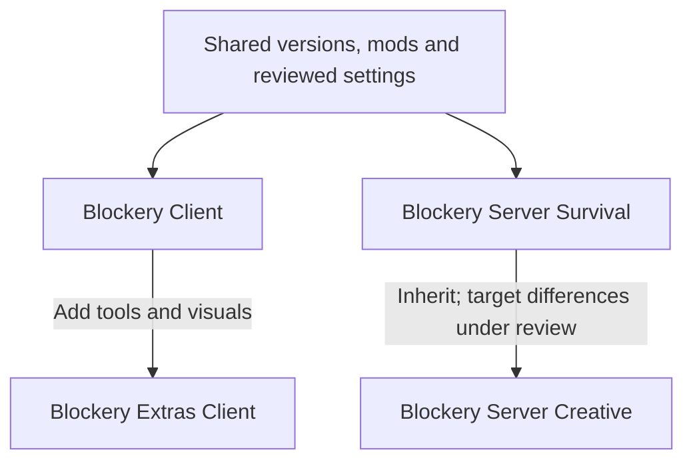

# Blockery

**Looking for the player packs?** Choose **Blockery Client** for everyday play, or
**Blockery Extras Client** if you want more building tools and visual extras.
You only need one, not both.

| Pack | Choose it if… | What you get |
| --- | --- | --- |
| **Blockery Client** | You want the lighter, everyday option. Start here if you're unsure. | Voice chat, maps, useful on-screen information, and optimization mods. |
| **Blockery Extras Client** | You want schematics, advanced building tools, inventory helpers, or extra visuals. | Everything in Blockery Client, plus tools such as Litematica, Axiom, JEI, and Tweakeroo. |

**Both client packs are still drafts, not approved releases.** Client testing and
settings review are unfinished. This page does not yet offer a released client download.

To join the server, start with the [Getting Started guide](https://blockery.notion.site/Getting-Started-568ff72b8dd24ce580cb377cfa1ffeaa)
for connection details and setup instructions. You don't need GitHub or build tools
to follow that guide, and the Blockery client pack is optional.
If you've been given a draft to try, see [installing a draft](#try-the-pack-in-prism-launcher).

## About Blockery

Vicious Blockery is a lightly modded private Minecraft server for friends and family.
The focus is building, smoother everyday play, and performance fixes, rather than
changing Minecraft into a different game.

This repository is where we keep the shared mod selections and reviewed settings.
It produces two player packs and two server packs from one source, so we don't have
to maintain a separate copy of everything for each one.

The current shared versions are **Minecraft 1.21.10** and **Fabric Loader 0.19.5**.
Coordinated upgrades and Modrinth publishing are still being set up.

## What's in the client packs?

### Blockery Client

The base pack has 13 mods and the Redstone Tweaks resource pack. Its main features are:

| For… | Included |
| --- | --- |
| Talking with friends | Simple Voice Chat |
| Finding your way | Xaero's Minimap and World Map |
| Seeing useful information | AppleSkin, Shulker Box Tooltip, Status Effect Timer, MiniHUD |
| Performance-related changes | Lithium, FerriteCore, ImmediatelyFast |
| Redstone readability | Redstone Tweaks, an optional resource pack |

Fabric API and MaLiLib support the other mods. The selection also retains View
Distance Fix, a server-focused fog fix, not a promised client FPS improvement.

### Blockery Extras Client

Extras includes the whole base pack, then adds specialist tools and visuals.
Some of the reasons you might choose it:

| For… | Notable additions |
| --- | --- |
| Schematics and advanced building | Litematica, Axiom, Tweakeroo, WorldEdit |
| Item lookup and inventory management | JEI, Inventory Profiles Next |
| Animated mobs | Fresh Animations, with Entity Model Features and Entity Texture Features |

Those are highlights, not the full list. Extras retains other previous client entries
pending review, for a total of 44 mods and two resource packs. The exact selections
are in [the build recipes](build/profiles.toml).

Having a tool installed doesn't grant permission to use it on a server. Axiom has
separate licensing and multiplayer requirements; server permissions still apply to
editing tools.

## Try the pack in Prism Launcher

If you're helping test a draft, ask the maintainer for the `.mrpack` file for your
chosen client. You don't need to download this repository or run commands yourself.
Maintainers can [build a draft below](#build-a-distribution).

1. In Prism Launcher, choose **Add Instance → Import** and select the `.mrpack` file.
2. Create a **new instance** and use **Java 21**. Don't overwrite your existing setup.
3. Launch Minecraft. In the resource-pack menu, enable **Redstone Tweaks** if wanted.
   Extras also includes **Fresh Animations**, which you can enable separately.
4. Follow the [quick playtest](docs/playtest.md): allow 10–15 minutes for launch,
   joining, controls, voice, and rejoining. Extras checks are optional.

The drafts don't include configuration or personal instance settings. Your existing
map history, MiniHUD setup, voice settings, and keybindings aren't copied over.
Defaults and shortcuts still need checking in a fresh instance before release.

## How the packs fit together

The arrows below show how packs are built, **not which server a player connects to**.
Extras adds to the base client; creative inherits the survival server selection.
Server packs are for the host, not for players to install.



Both server recipes currently select the same 30 mods and 11 reviewed gameplay
configuration files. Settings unique to a server belong under `deploy/targets/`,
not in a copied pack. Worlds, player data, and other live server files stay outside
this repository.

Survival's `2026.10.12` candidate passed local checks and was submitted to Modrinth
by the owner; approval is pending. Creative and both clients still have checks to
complete before release. See the [deployment notes](deploy/README.md) for the
server layout and [project terminology](CONTEXT.md) for more detail.

## For maintainers

Players can stop here. The sections below cover building packs and changing their source.

### Build a distribution

You'll need `uv` and the [pinned Packwiz build](docs/tooling.md). The Python builder
selects content using this repository's recipes; these are not a native Packwiz feature.

```sh
uv run --script scripts/build_pack.py list
uv run --script scripts/build_pack.py plan blockery-client
uv run --script scripts/build_pack.py build blockery-client --version naming-preview --draft
uv run --script scripts/build_pack.py build blockery-extras-client --version naming-preview --draft
```

The client commands create:

- `local/dist/blockery-client-naming-preview-draft.mrpack`
- `local/dist/blockery-extras-client-naming-preview-draft.mrpack`

`local/dist/` is ignored by Git. Draft versions and filenames end in `-draft` and
are not for publication. Existing outputs aren't overwritten; use a new version
label if a file already exists. Normal release builds are blocked while a recipe
has pending checks.

Don't use root `packwiz modrinth export` for the named packs: it bypasses recipe
selection and release checks. The [tooling guide](docs/tooling.md#distribution-builder)
covers recipe editing, validation limits, and tests.

### Find your way around the repository

| Location | Purpose |
| --- | --- |
| `pack.toml`, `index.toml` | Shared Minecraft/loader versions and Packwiz's file index. |
| `mods/`, `resourcepacks/`, `config/` | Download metadata and reviewed shared settings. Mod and resource-pack downloads aren't committed here. |
| `build/` | Recipes for each pack and reversible mod exclusions. |
| `scripts/`, `tests/` | Build, validation, and maintenance tools, with offline fixture tests. |
| `deploy/targets/` | Reserved for verified server-specific settings; no differences have been confirmed yet. |
| `.github/workflows/validate.yml` | Automated checks and short-lived draft artifacts, not public releases or deployments. |

For a specific task:

- **Build or validate:** [Tooling](docs/tooling.md).
- **Review upgrades or rollback:** [Upgrade guide](docs/upgrades.md). The tools report
  candidates and audit locally supplied pinned JARs; automated version application
  isn't implemented yet.
- **Move personal client data:** [Local sync guide](docs/local-sync.md).
- **See planned work:** [Project workbench](todo/README.md).

### Making changes

Make changes here first, not by copying unreviewed files back from a live server.
After changing indexed configuration or Packwiz metadata, run `packwiz refresh`,
then review `packwiz list` and the Git diff.

Keep worlds, player data, logs, backups, credentials, and private keys out of the
repository. The [deployment notes](deploy/README.md) explain how shared settings
and server-specific settings fit together.

## License

Original Blockery build scripts, pack definitions, documentation, and original
configuration contributions are licensed under **GPL-3.0-or-later**. You may
redistribute and modify that material under the GNU General Public License,
version 3 or any later version. It is provided without warranty; see [LICENSE](LICENSE).

Third-party mods, libraries, resource packs, generated configuration text, and
other upstream material retain their own terms and notices. In particular, Axiom
retains its separate license and multiplayer/commercial-use requirements.
